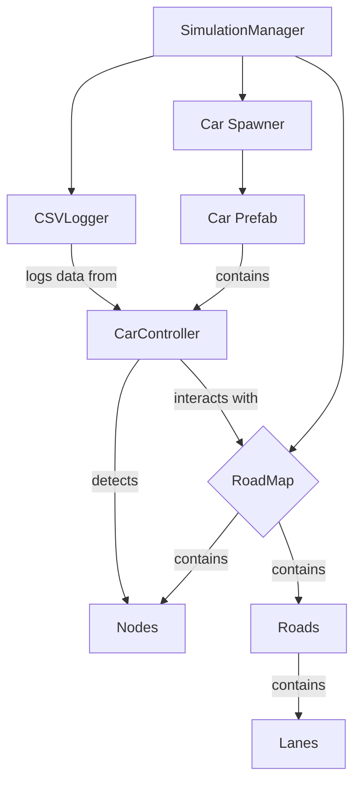

# 3D Road Traffic Simulation - Phase One Plan

## 1. Project Overview

This document outlines the plan for creating a 3D road traffic simulation in Unity. The initial phase focuses on creating a functional, non-visual simulation on a 2D plane. The primary goal is to simulate car movement, intersection logic, and data logging.

## 2. Core Requirements & Constraints

### Functional Requirements
- **Simulation Environment:** The simulation will run on a 2D plane (X and Y axes), with the Z axis being constant for all elements.
- **Road Network:**
    - The road network must be a closed, interconnected loop.
    - All roads will be two-lane.
    - The network must contain at least four intersections.
    - Each generation must produce a non-deterministic layout: road lengths, intersection spacing, and offsets vary every run within configured ranges to create irregular grid patterns similar to the provided reference.
    - Provide a configuration asset or scriptable object exposing minimum/maximum segment lengths, intersection jitter, allowable turn angles, and random seed settings to control the generator.
- **Vehicles (Cars):**
    - The number of cars in the simulation must be configurable.
    - Cars will move along the roads.
    - Car motion must be continuous with position and heading updated each frame; no teleporting between segments.
    - Movement should respect configurable acceleration, deceleration, and target speed values to avoid instantaneous velocity changes.
    - At intersections, cars will follow precomputed arc/curve paths to achieve natural turning motion and will randomly choose which available turn to take (excluding turning back).
    - Cars will only stop moving if there is another car directly in front of them on the same lane, or if required by intersection logic.
- **Intersection Logic:**
    - Intersections will not have traffic lights.
    - Cars must follow the "priority to the right" rule at intersections.
- **Data Logging:**
    - The 3D position of each car must be logged to a CSV file.
    - The CSV format will be: `carID,positionX,positionY,positionZ,time`.

### Constraints & Simplifications
- **Visuals:** Visual aspects are not a priority. Simple geometric shapes (e.g., cubes, spheres) can represent cars and roads.
- **Physics:** Complex physics simulation is not required. Kinematic movement is sufficient.
- **Environment:** No buildings, sidewalks, pedestrians, or other environmental elements are needed for this phase.
- **Road Generation:** A procedural generation approach for the road network is preferred for flexibility, but a hard-coded map is acceptable if it's simpler to implement initially.

## 3. Development Steps

The development will be broken down into the following main stages:

### Stage 1: Road Network Generation
1.  **Data Structures:** Define the data structures for the road network. This will include classes or structs for:
    - `Node`: Represents an intersection or a point on a road.
    - `Road`: Connects two `Node`s and contains information about lanes, segment lengths, and curvature data for turn arcs.
    - `Lane`: A segment of a `Road` where cars can travel.
    - `RoadMap`: A container for all `Node`s and `Road`s.
    - Optional helper structs for `TurnCurve` or spline metadata that define the natural arcs available between connected lanes at intersections.
    - `RoadGenerationConfig`: Stores bounds for segment length, intersection jitter, lane width, and random seed overrides.
2.  **Generation Logic:** Implement a procedural generator for the road map.
    - The generator will create a grid-based road network with randomized spacing: each horizontal and vertical segment length, node offset, and branching depth is sampled per run within configurable bounds.
    - Apply noise-based or jitter offsets so intersections slide vertically/horizontally, producing the staggered layout shown in the reference diagram.
    - Enforce constraints such as minimum loop perimeter, maximum skew between adjacent lanes, and minimum Manhattan distance between nodes to avoid overlapping geometry.
    - It will ensure the network remains a closed loop and has at least four intersections even after randomization by connecting boundary nodes and verifying graph connectivity.
    - Generation should support irregular grids with offset intersections similar to the provided reference diagram, optionally by perturbing a base grid and inserting additional connecting roads.
    - Precompute turn curves (circular arcs or quadratic Bézier splines) for every valid movement between lanes, storing curvature radius and arc length for later motion calculations.
    - For debugging, expose a seed override to reproduce layouts when needed and log the chosen seed per run.
3.  **Visualization (Debug):** Create a simple script to visualize the generated road network using Unity's Gizmos or Debug.DrawLine for verification.
    - Extend visualization to render intersection nodes, lane centerlines, and the curvature arcs that will be used for turning.
    - Display randomized metrics (segment length, node offsets) in the Scene view to validate generator constraints.

### Stage 2: Car Spawning and Movement
1.  **Car Prefab/Object:** Create a basic `Car` prefab or GameObject in Unity.
2.  **Car Component:** Create a `CarController` C# script. This script will manage:
    - The car's ID.
    - Its current position and velocity.
    - The logic for following a continuous path along the road network's lanes and associated turn curves, maintaining smooth transitions without teleportation.
    - A spline follower that evaluates lane centerlines and turn curves using parametric time, supporting look-ahead steering for smooth arcs.
    - Speed control that accelerates toward a target velocity, clamps jerk, and blends braking when approaching stopped traffic or intersections.
3.  **Spawning System:** Create a `SimulationManager` script that will:
    - Hold a reference to the `RoadMap`.
    - Spawn a configurable number of `Car` prefabs at random positions on the road network.
    - Assign a unique ID to each car.
    - Initialize each car with lane assignment, travel direction, and initial parametric progress so cars never spawn overlapping.

### Stage 3: Data Logging
1.  **CSV Logger:** Create a `CSVLogger` script.
2.  **Logging Mechanism:**
    - The `SimulationManager` will invoke the `CSVLogger` at regular time intervals.
    - The logger will iterate through all active cars and record their `carID`, `positionX`, `positionY`, `positionZ`, current lane ID, and the current simulation `time`.
    - The data will be written to a file (e.g., `car_positions.csv`).
    - The logger should handle file creation and appending data.
    - Provide configuration for logging cadence (e.g., every `n` simulation steps or fixed seconds) and flush the file handle periodically to avoid data loss.

### Stage 4: Intersection Logic
1.  **Intersection Detection:** Implement a mechanism for cars to detect when they are approaching an intersection. This can be done using trigger colliders on the intersection nodes.
2.  **Priority Rule:** Implement the "priority to the right" logic.
    - When a car approaches an intersection, it will check for other cars in or approaching the same intersection.
    - It will yield (stop) to any car that is on its right.
    - After yielding, or if the intersection is clear, the car will choose a random valid path to continue, aligning onto the selected turn arc or straight segment smoothly.
    - Maintain an intersection occupancy data structure that tracks queued cars per incoming lane, allowing deterministic right-of-way checks and preventing simultaneous entry conflicts.
    - A simple state machine (e.g., `Approaching`, `AtIntersection`, `Crossing`) within the `CarController` can manage this behavior, including blending velocity along curve segments.
    - Use raycasts or trigger volumes sized to the stop line distance to anticipate other vehicles and request intersection access in advance.

## 4. System Architecture (Mermaid Diagram)



## 5. TODO List

This plan will be converted into a TODO list to track progress.

-   [ ] **Stage 1: Road Network**
    -   [ ] Define data structures for `Node`, `Road`, `Lane`, `RoadMap`, `TurnCurve`, and `RoadGenerationConfig`.
    -   [ ] Implement procedural road map generator with randomized spacing, loop validation, and curve precomputation.
    -   [ ] Implement debug visualization for the road map, including metrics display.
-   [ ] **Stage 2: Car Spawning and Movement**
    -   [ ] Create `Car` prefab and `CarController` script.
    -   [ ] Implement car movement logic along lanes with spline following and acceleration control.
    -   [ ] Implement `SimulationManager` to spawn cars without overlaps and manage lane assignments.
-   [ ] **Stage 3: Data Logging**
    -   [ ] Create `CSVLogger` script.
    -   [ ] Implement data logging functionality in `SimulationManager` with configurable cadence.
-   [ ] **Stage 4: Intersection Logic**
    -   [ ] Implement intersection detection and occupancy tracking.
    -   [ ] Implement "priority to the right" rule with queuing and smooth turn selection.
-   [ ] **Finalization**
    -   [ ] Integrate all systems.
    -   [ ] Test the simulation with a variable number of cars.
```
<line_count>130</line_count>
</write_to_file>